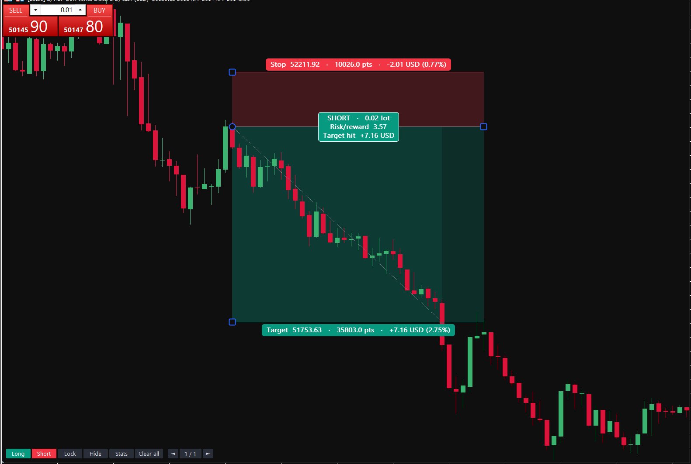

# Position Planner for MetaTrader 5

A TradingView-style Long/Short position tool for MetaTrader 5.
Drag Entry / Stop / Target on the chart, get the lot size for your risk, see how the trade
would have played out on real bars, link boxes to your real trades, keep statistics and export
everything to JSON.

The indicator only draws and calculates: **no DLL, no internet access, it never places or
modifies any order.** Placing an order from a box is a separate, optional script that always
asks for confirmation.

## Files

| File | What it is |
|---|---|
| `MQL5/Indicators/PositionPlanner.mq5` | The position tool (indicator) – source |
| `MQL5/Indicators/PositionPlanner.ex5` | The same, compiled – ready to use |
| `MQL5/Scripts/PositionPlannerOrder.mq5` | Optional: places an order from the active box – source |
| `MQL5/Scripts/PositionPlannerOrder.ex5` | The same, compiled – ready to use |

The `.ex5` files are compiled from the `.mq5` sources in the same folder (MetaEditor, 0 errors,
0 warnings) and are updated together with them.

Each file has an internal version number (`PP_VERSION` in the indicator, `PPO_VERSION` in the
script), raised with every change. The indicator's version is shown in the chart's indicator
list, e.g. *PositionPlanner (1.01)*, so you can see which build is running.

## Installation

1. In MetaTrader 5: **File → Open Data Folder**.
2. Copy `PositionPlanner.ex5` into `MQL5\Indicators` (and optionally `PositionPlannerOrder.ex5`
   into `MQL5\Scripts`), then right-click the Navigator → **Refresh** (or restart the terminal).
   - Or compile it yourself: copy the `.mq5` files instead, open them in MetaEditor and press
     **Compile** (F7).
3. Drag **PositionPlanner** from the Navigator onto a chart.

## Position Planner (indicator)

### Usage
- Click **Long** or **Short** in the panel, then click on the chart: the box starts at the clicked
  bar, Entry at the clicked price, default Stop = 1.5 × ATR(14) (or fixed pips), Target by the
  default R:R.
- Drag the handles, like TradingView:
  - left corners: Target / Stop – up and down only, the box does not move sideways
  - left circle: Entry (and the left edge)
  - right middle: width only (shortening the box never moves your levels)
- Drag the inside of the box to move it as a whole. Dragging Target across Entry flips
  Long ↔ Short. A dashed crosshair shows the exact price while dragging.
- Lines snap to your open trades and pending orders (can be disabled).
- **Right-click** a box: Lock / Unlock, Export box (this box only, to
  `MQL5\Files\PositionPlanner\<symbol>_<TF>_<time>_box<id>.json`, works without the Export button), Delete.
- **Delete** key removes the active box, **Esc** cancels placement or closes the menu.

### What you see
- Target and Stop labels: price, distance (pips or points), money and % of balance.
- Middle label: direction, lot size for your risk, Risk/Reward and the result.
- Lot size is rounded down to the volume step, so the risk does not exceed your setting – except
  when even the minimum lot risks more: then the minimum lot is used and marked `(MIN!)`.
  A zero risk setting gives no lot size.
- Trade simulation on real bars: when price reaches Entry inside the box, the tool checks whether
  Target or Stop is hit first and shows *Target hit*, *Stop hit* or the open P&L (Bid for long /
  Ask for short). One bar does not tell the order of prices inside it, so when it matters
  (Stop or Target inside the entry bar, or Stop and Target in the same bar) the tool looks at
  the **M1 bars** inside that bar and takes what really came first. The M1 bars are used only
  when they rebuild the chart bar exactly (open, high, low, close and tick volume). If M1 cannot
  decide – the chart is M1 or above D1, the M1 history is not loaded yet or does not match the
  bar, or everything happened in one minute – the simulation is conservative: Stop and Target in the same bar = Stop; a Stop
  inside the entry bar = Stop; a Target inside the entry bar alone does not count (the next bars
  decide). While MT5 is still loading M1 history a box can first show the conservative result
  and then update itself. A box without Stop or Target (e.g. an unlinked real-trade box) never
  "hits" the missing level.
- Money is shown only when it can be calculated; otherwise the value is left out (never 0.00).
- Labels and handles appear only for the hovered or clicked box.
- Boxes belong to the symbol they were drawn on: when the chart switches to another symbol they
  are hidden, and they come back when the chart returns to their symbol. **Clear all** removes
  only the boxes of the current symbol.

### Box from a real trade
Click **Long** or **Short**, then click a trade arrow on the chart. The box is linked to that
position and shows its real result from the account history: entry, initial SL/TP, exit,
money incl. commission and swap and the close reason (Target hit, Stop hit, Break-even,
Closed manually, Closed by EA, Stop out). Lots come from the real trade and % from the balance
right before the entry, so changing the risk inputs never changes a linked box. Moving the box
or editing its levels turns it into a normal simulated box.

- A Stop / Target that was not on the opening order (added or moved after the entry) is shown as
  *Stop (set later)* / *Target (set later)* – the box then uses the level of the position now or
  at the close, which is not the initial one.
- If the account history of the trade is not available, the box shows *Real result n/a* and is
  left out of the statistics – it is never replaced by a simulated result.

### Panel
`Long | Short | Lock | Hide | Stats | Export | Restore | Clear all | ◄ n / total ►`
- **Stats**: boxes, triggered, win / loss / break-even / open, win rate, total in R and money
  (*money n/a* when a counted box has no money result; *n/a* = linked boxes without history).
  *Max drawdown*: the largest fall of the running total (in R and money) from its previous peak,
  closed trades in the order they were closed. The exit time is exact for real trades, the M1
  minute for simulated boxes resolved on M1, otherwise only the bar. Trades whose exit times
  overlap (order unknown) are taken in their worst possible order; the value is then marked
  *(worst case)* – the real drawdown is never higher (in rare cases of several chained overlaps
  it can be lower). R and money are calculated separately. *R n/a* when a
  closed box has no Stop (no R). *Avg time in trade*: from entry to exit of the
  closed trades – exact for real trades; simulated boxes are measured by bar times, so the value
  is marked `~` (bar precision).
  *Open boxes* lists which boxes are still open (triggered, neither Stop nor Target hit inside
  the box) by their number in the panel counter `◄ n / total ►` – step to them with ◄ ►.
- **◄ ►**: jump between all boxes on the chart.
- **Export** (enable *Show Export button* in inputs): all boxes (or only locked ones) with their
  results to `MQL5\Files\PositionPlanner\*.json` – for spreadsheets, scripts or AI analysis.
- **Restore** (shown together with Export): brings boxes back, e.g. after MT5 crashed or was
  killed and the chart was lost (MT5 saves charts and their objects only on a normal exit).
  It takes the newest backup or full export of the chart's symbol and timeframe that has boxes
  not on the chart yet. The first click shows the file and how many boxes it would add (in the
  stats box next to the panel), a second click within 15 s restores them (levels, times, Lock and
  the link to a real trade). Boxes already on the chart are skipped, so nothing is doubled.
  Not used: single-box exports, *export only locked boxes* exports and files that are incomplete
  or damaged (e.g. cut off by a crash). A linked box from a file of another account or server
  is restored as a normal box (its position id means nothing here); if its real Stop / Target was
  already past the entry (trailing, break-even) it is skipped. Files written before version 1.08
  have no account and are taken as this account's.
- **Auto backup** (input, off by default): after every change the boxes of the chart are saved
  to `MQL5\Files\PositionPlanner\backup\<account>_<symbol>_<TF>.json`. The file is written to a
  temporary file first and checked, so a crash while saving never destroys the last good backup;
  a failed save is retried after 5 s. If a backup holds boxes that are not on the chart (a lost
  chart), it is first kept as `<account>_<symbol>_<TF>_prev_<time>.json` (never overwritten, the
  newest 5 are kept), so Restore still finds it.
  Two charts with the same symbol and timeframe share one backup file – the last change wins.

### Known limitations
The indicator works with the data MT5 gives an indicator, so some values are close but not exact:
- **Money in the indicator** uses the symbol's tick value (MT5 does not allow `OrderCalcProfit`
  in indicators). For pairs whose tick value moves with the price (e.g. USDJPY on a USD account)
  the money at Stop / Target can differ slightly from the real one. The order script shows the
  exact money (`OrderCalcProfit`) before anything is sent.
- **Old boxes** of cross pairs (e.g. EURGBP on a USD account) are valued at today's conversion
  rate; results in R are not affected.
- **Simulation uses chart bars** (Bid). A short position really closes at Ask, so in the
  simulation its Stop is hit about one spread later and its Target one spread earlier.
- **Real trade boxes** are made for hedging accounts. On netting accounts a position reversal
  (one deal closing and opening the opposite side) is not split into its parts.
- A real trade box finds its open position by the position ticket; brokers that reopen
  positions with a new ticket (e.g. at the swap rollover) can make an open trade look closed.

### Safety
While the mouse is over a box, MT5 dragging of real order/position levels and the MT5
right-click menu are temporarily disabled, so you can never move a real SL/TP by accident.

### Inputs
- Risk mode (% of balance, % of equity, fixed money, fixed lots) and risk value
- Default SL (0 = auto 1.5 × ATR14), default R:R, box width in bars, pip size mode, snap
- Colors, zone / trade area opacity, font size, panel corner and offsets
- Show Export (and Restore) button, export only locked boxes, auto backup, debug log

## Position Planner Order (optional script)

Places an order from the **active** (clicked) box on the chart. It always asks twice:

1. **Inputs window** – order type:
   - *Pending at box entry* – Buy/Sell **Limit** or **Stop**, chosen by where the entry is
     relative to the current price
   - *Market now* – opens immediately at the current price
   - *Market: max price change after confirmation / slippage* (points, default 10) – checked
     before sending; the server enforces it as slippage only with Instant / Request execution.
     With Market execution the broker fills at its current price (the confirmation says so).
2. **Confirmation** with the order, Stop / Target with money and %, R:R, the margin of this order
   and the free margin (after the order for market, now for pending) – each shown only when MT5
   can calculate it exactly. **Yes** sends, **No** (default) does nothing.

Stop, Target, lots and comment `PositionPlanner #<box>` come from the box. Boxes linked to a real
trade are refused. Requires **Algo Trading** to be enabled.

Before anything is sent the script checks:
- the box belongs to the chart symbol, has a lot size and a Stop, and its levels are valid prices
  (above zero, Stop / Target on the correct side of the entry)
- lot size: volume step, min / max lot and the symbol's volume limit (open positions + pending
  orders in one direction)
- the broker's minimum stop distance (stops level) for the entry, Stop and Target
- the exact request with MT5 `OrderCheck` (margin, filling, expiration…)
- netting accounts: refused while the symbol already has an open position (the order would be
  merged into it and the box Stop / Target would apply to the whole position); for a pending
  order the confirmation warns that it merges if a position exists when it fills

After **Yes** the box and the price are read again. If the box changed, the price moved more than
the allowed points (market) or crossed the entry (pending), the confirmation is shown again with
the updated values. A partial market fill is reported with the real filled volume.

Tip: Navigator → Scripts → *PositionPlannerOrder* → right-click → **Set hotkey**.

## License

MIT – free to use, modify and share; keep the copyright notice
(© 2026 otaznik.sk - Michal Škop). See [LICENSE](LICENSE).
